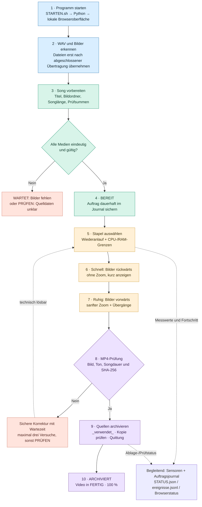

# Funktionsdiagramm 01 – Einfacher Ablauf

**Version:** 1.0 · **Quellstand:** `56162cc6a1b3e1e00d61c77c78518cd7e372a17d` · **Stand:** 01.11.2026.

Dieses Diagramm übersetzt die beiden getrennten Workflows und die Ausgabeabsicherung in einfache Schritte. Es ersetzt keine Funktionsprüfung.

### Was die Pfeile bedeuten

Der Eingang darf unabhängig vom Video-Renderer weiterarbeiten. `WARTET` ist **kein** Datenfehler; ein unklarer oder beschädigter Datensatz bleibt unter `PRÜFEN`. Erst nach einer geprüften MP4 und bestätigter Archivierung erreicht der Auftrag 100 %.

**Dateiorte:** `Downloads/` → `EINGANG/<song>/BILDER/` → `PROTOKOLLE/auftraege.json` → `FERTIG/*.mp4` und `VERWENDET/*_verwendet_*`.

**Hinweis zur Bildablage:** Die separate Kategorisierung `BILDER/PROVOWARE|CODING|THEMA` ordnet Bilder **noch keinem Song** zu. Das passiert erst durch dessen eigenen `EINGANG/<song>/BILDER`-Ordner.

**Änderungspflicht:** Nach einer Änderung an `vorbereiten`, `stapel`, `_render`, `_archive` oder der Datenstruktur den Fluss mit Code und Tests erneut abgleichen.
