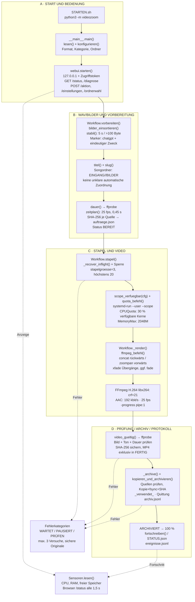

# Funktionsdiagramm 02 – Technischer Daten- und Befehlsfluss

**Version:** 1.0 · **Quellstand:** `56162cc6a1b3e1e00d61c77c78518cd7e372a17d` · **Stand:** 01.11.2026.

Die Begriffe in Klammern sind tatsächliche Python-Funktionen aus diesem Repository. Werte ohne Zusatz sind **Standardwerte** und können teilweise in Einstellungen geändert werden.



### Übermittelte Daten und häufigste Parameter

| Übergang | Eingaben | Ausgabe / Wirkung |
|---|---|---|
| Browser → Python | `POST /aktion` mit `prepare`, `batch`, `once`, `watch`, `stop` | startet genau einen Workflow; nicht zwei konkurrierende Writer |
| Einstellungen → Kern | `downloads`, `arbeitsordner`, `format`, `kategorie`, `fps`, `uebergang`, `stapelgroesse` | validierte Konfiguration |
| WAV → Vorbereitung | Dateipfad, Datum, Dateigröße, Titel, Bilder | Dauer, Bildliste, Quell-SHA-256; Status BEREIT/WARTET/PRÜFEN |
| Vorbereitung → Journal | `titel`, `status`, `dateien`, `laenge`, `versuche` | `PROTOKOLLE/auftraege.json` |
| Journal → FFmpeg | WAV und 1–40 Bilder, Gesamtzeit, Zielauflösung | zwei Bildfolgen mit einer Tonspur |
| FFmpeg → Prüfung | temporäre MP4 | `ffprobe` prüft Bild + Ton + Dauer; SHA-256 des Videos |
| Prüfung → Archiv | verifizierte MP4 + Quell-SHA-256 | Quelle erst nach geprüfter Kopie löschen, Quittung schreiben |
| Status → Browser | Sensoren, Auftragszähler, `phase`, `prozent` | drei getrennte Fortschrittsanzeigen, Protokoll |

### Verwendete Befehle (verkürzt, kein direkt kopierbarer vollständiger Renderbefehl)

```text
python3 -m videozoom
ffprobe -v error -show_entries format=duration:stream=codec_type,width,height -of json DATEI
systemd-run --user --scope -p CPUQuota=…% -p MemoryMax=…M -- ffmpeg …
ffmpeg -loop 1 ... -filter_complex "concat;zoompan;xfade" -c:v libx264 -crf 21 -c:a aac -b:a 192k -progress pipe:1 …
```

**Sicherheitsgrenze:** In normalen Läufen muss `systemd-run` funktionieren; fehlt die wirksame Quotenprüfung, wird **nicht ungebremst gerendert**. Der eigenständige Testmodus ersetzt diese Begrenzung **nur** für isolierte Tests. `FFmpeg`-Parameter werden vom Kern erstellt, nicht vom Browser als frei ausführbare Befehle übergeben.
